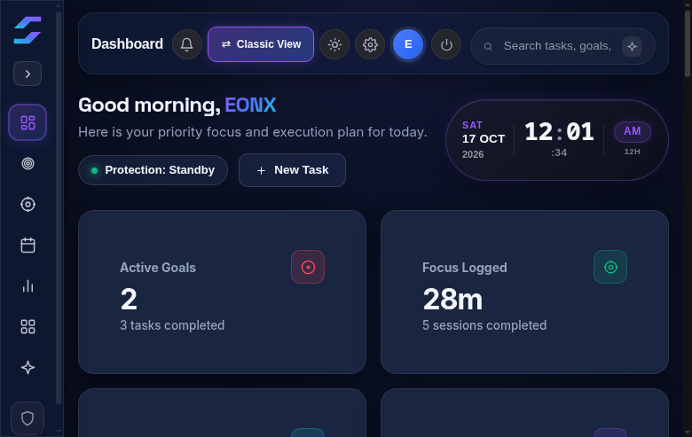
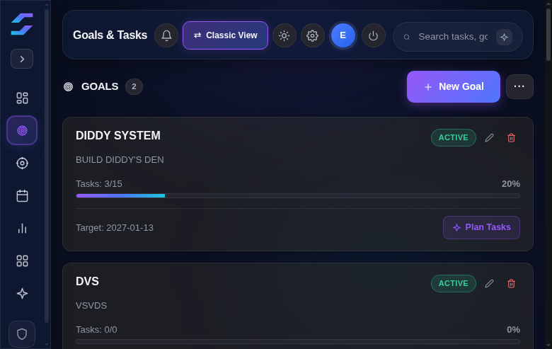
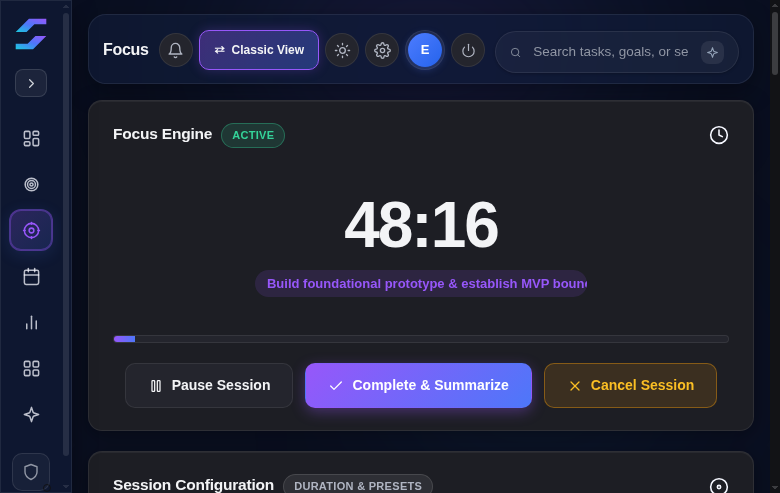
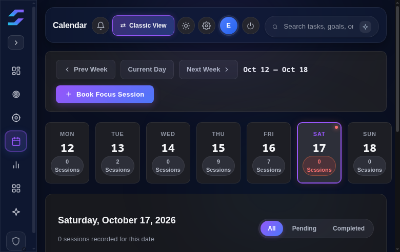
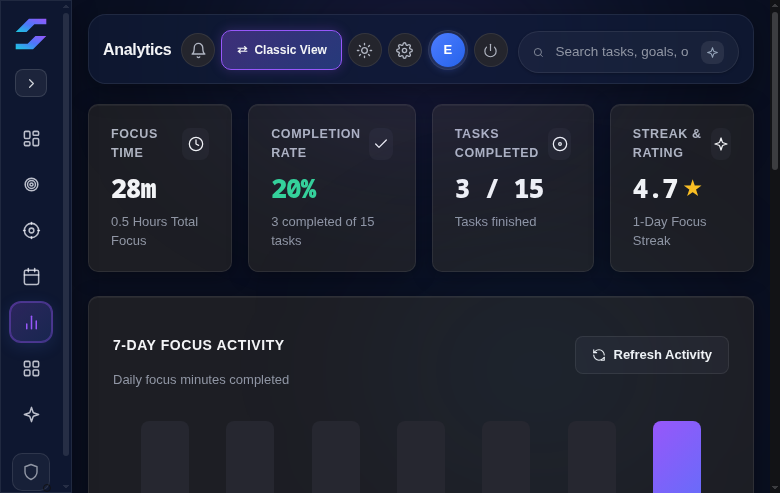
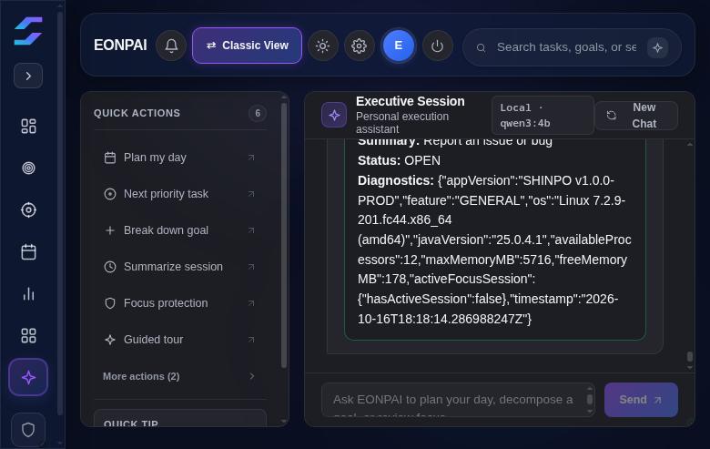
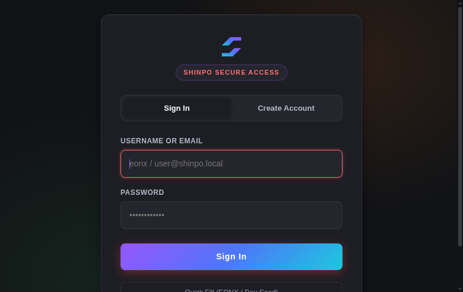

# SHINPO — Personal Execution Operating System

**Target Release:** `v0.1.0-beta.1` (Private Beta)  
**Architecture:** Standalone Local-First Desktop Application (Tauri 2.0 + Rust + React 19 + TypeScript + SQLCipher)

---

## 1. Overview

**SHINPO** is a privacy-first, offline-capable personal execution desktop application designed to bridge high-level life goals with focused, distraction-free daily execution.

It operates **100% offline** without requiring external cloud accounts, remote telemetry, Spring Boot, PostgreSQL, Docker, or centralized servers. All data—including goals, tasks, focus records, reflections, and configuration—is encrypted on your device inside an Argon2id/SQLCipher vault.

---

## 2. Core Capabilities

- **Focus Engine:** Configurable Pomodoro and Deep Work timers supporting transitions: `READY` → `ACTIVE` → `PAUSED` → `ACTIVE` → `COMPLETED`. Includes durable post-session reflections and distraction logging.
- **Goals & Tasks Kanban:** Multi-tier decomposition of long-term milestones into bite-sized actionable tasks with scheduled dates and estimated durations.
- **Analytics & Contribution Skyline:** Second-level activity tracking with interactive 2D heatmaps and 3D architectural Skyline visualizations.
- **Focus Guardian (Warning-Only):** Background app observation that monitors distracting desktop processes. **Strictly warning-only:** SHINPO never force-terminates or closes operating system processes.
- **Browser Companion:** Lightweight WebExtension (Chromium & Firefox) connecting via local native messaging to enforce site policies during active focus sessions.
- **EONPAI (Executive Assistant):** Provides deterministic offline task decomposition, daily schedule proposals, and session debrief analysis. Supports optional user-configured local models via Ollama or custom OpenAI-compatible endpoints.
- **Progress & Milestones:** Local XP and milestone tracking using stable event keys that prevent duplicate awards or collision upon task recreation.

---

## 3. Real Application Screenshots

| Feature | Theme | Preview |
|---|---|---|
| **Dashboard Overview** | Aurora Dark |  |
| **Goals & Tasks Kanban** | Aurora Dark |  |
| **Focus Engine** | Aurora Dark |  |
| **Calendar Scheduler** | Aurora Dark |  |
| **Analytics & Skyline** | Aurora Dark |  |
| **EONPAI Assistant** | Aurora Dark |  |
| **Secure Vault Access** | Aurora Dark |  |

---

## 4. Platform Support & Installation

### Supported Platforms
- **Linux (x86_64):** Fully tested and verified on Fedora 40+ (RPM) and Debian/Ubuntu (DEB/AppImage).
- **Microsoft Windows (x64):** Packaged via NSIS installer.  
  *Note:* Windows NSIS installers are generated by CI, but **runtime execution under native Windows WebView2 has not yet been executed on this Linux host (flagged honestly as NOT TESTED)**.

### Installation Instructions

#### Linux (RPM — Fedora / RHEL)
```bash
sudo dnf install ./SHINPO-0.1.0-1.x86_64.rpm
shinpo-desktop
```

#### Linux (Debian / Ubuntu)
```bash
sudo dpkg -i ./SHINPO_0.1.0-beta.1_amd64.deb
shinpo-desktop
```

#### Linux (AppImage — Any distribution)
```bash
chmod +x ./SHINPO_0.1.0-beta.1_amd64.AppImage
./SHINPO_0.1.0-beta.1_amd64.AppImage
```

#### Windows (NSIS Installer)
```powershell
# Run the current-user installer (does not require admin privileges):
.\SHINPO-Setup-0.1.0-beta.1.exe
```

---

## 5. Local Development & Verification

### Prerequisites
- Node.js 22+, npm
- Rust 1.80+, Cargo
- Platform development libraries: `libwebkit2gtk-4.1-dev`, `libssl-dev`, `libayatana-appindicator3-dev`

### Development Server
```bash
# Install frontend dependencies
npm --prefix frontend ci

# Run in live desktop development mode
npm --prefix frontend run tauri:dev
```

### Verification & Testing
```bash
# Run headless native persistence smoke test (verifies SQLCipher creation & recovery)
cargo run --locked --manifest-path frontend/src-tauri/Cargo.toml --bin shinpo-desktop -- --smoke-test

# Run frontend tests & linter
npm --prefix frontend test
npm --prefix frontend run lint

# Run full consolidated quality gate
npm run check:all
```

---

## 6. Security Architecture & Advisories

- **Vault Protection:** Sensitive user credentials, tokens, and history persist exclusively inside encrypted SQLCipher/Argon2id vaults (`~/.shinpo/vault.sqlcipher`). Tampering with database headers or ciphertext results in immediate cryptographic rejection without fallback.
- **IPC Isolation:** Webview capabilities are restricted via Tauri v2 contracts; `connect-src` is locked to `ipc: http://ipc.localhost`.
- **Known Security Advisory (`RUSTSEC-2024-0429`):**  
  `cargo audit --deny unsound` flags `glib 0.18.5` (an upstream transitive dependency of Tauri's Linux GTK bindings). SHINPO does not call the affected `VariantStrIter` API. This is an accepted risk for supervised private beta evaluation, fully documented in [`docs/qa/RISK_ACCEPTANCE.md`](docs/qa/RISK_ACCEPTANCE.md).

---

## 7. Licensing Status

**Proprietary / All Rights Reserved.**  
SHINPO source code is currently provided for private evaluation by authorized beta testers. An open-source license has not yet been designated by the project owner. See [`docs/qa/HANDOFF.md`](docs/qa/HANDOFF.md) for licensing roadmap details.
