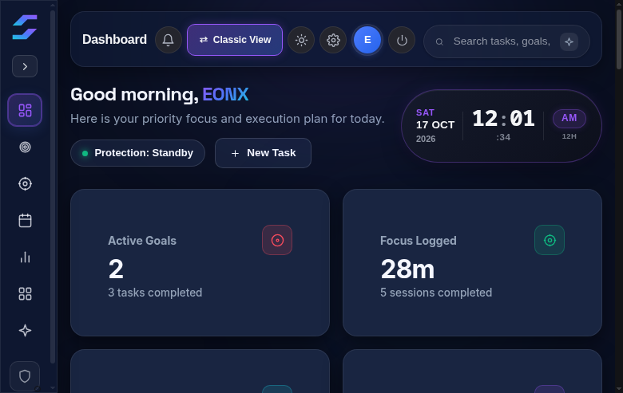
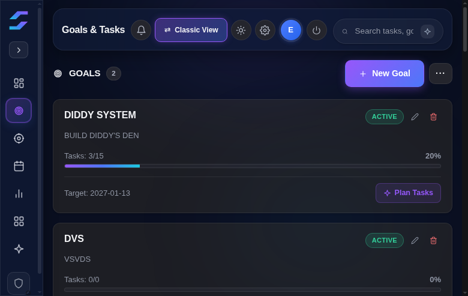
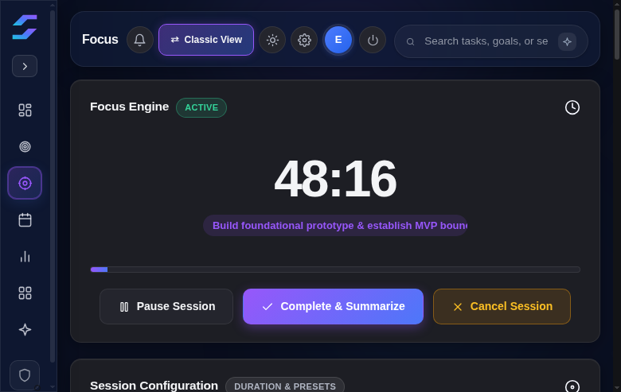
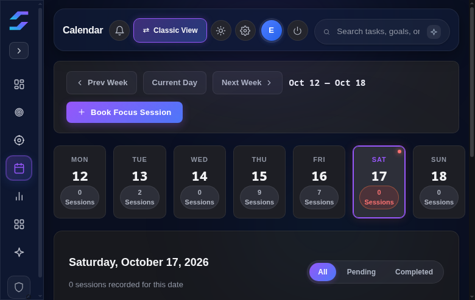
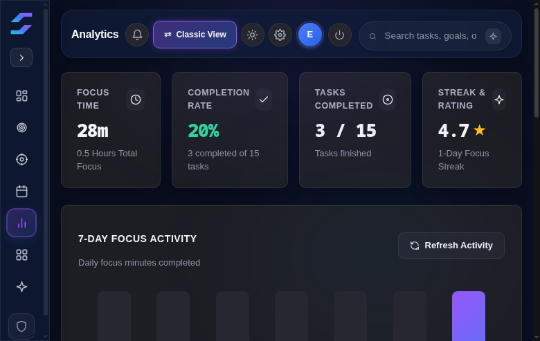
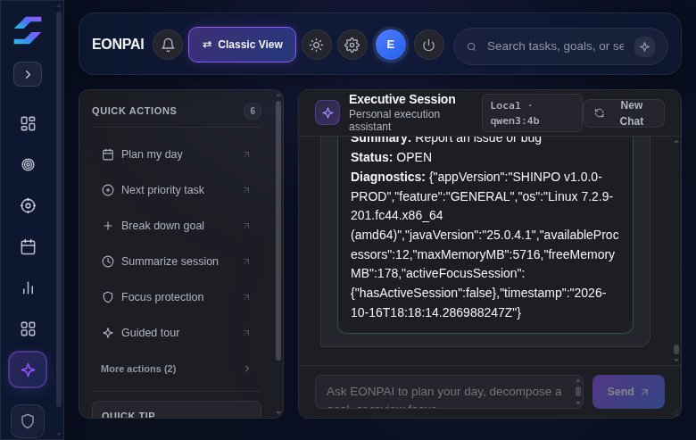

<div align="center">
  
  <h1>SHINPO</h1>
  <p><strong>進歩 · Progress, made intentional.</strong></p>
  <p>A local-first personal execution workspace for turning long-term goals into meaningful daily action.</p>
  <p>
    <a href="https://github.com/ronartz/SHINPO/releases"></a>
    
    
    
  </p>
  <p>
    <a href="#inside-shinpo">Explore SHINPO</a> &nbsp;·&nbsp;
    <a href="#screenshots">Screenshots</a> &nbsp;·&nbsp;
    <a href="#privacy--safety">Privacy &amp; Safety</a> &nbsp;·&nbsp;
    <a href="https://github.com/ronartz/SHINPO/releases">Releases</a>
  </p>
</div>

<p align="center">
  
</p>

<p align="center">
  <sub>Plan deliberately. Protect your focus. Follow through.</sub>
</p>

---

## The idea

**SHINPO (進歩)** means *progress*. It is built around a simple loop:

**Set a direction → choose the next action → make time for focused work → review what moved forward.**

SHINPO brings goals, tasks, sessions, scheduling, focus protection and progress into one desktop workspace. The aim is not to give you another dashboard full of numbers. It is to help turn intentions into work you can actually finish.

> **Built local-first. Designed for deliberate work.**

## Inside SHINPO

<table>
  <tr>
    <td width="50%" valign="top">
      <h3>🎯 Goals &amp; Tasks</h3>
      <p>Break larger objectives into actionable tasks. Organize work in list or board views, set target dates, track execution and keep the next step visible.</p>
    </td>
    <td width="50%" valign="top">
      <h3>⏱️ Focus Engine</h3>
      <p>Run focused work sessions with configurable durations, breaks, pause and resume controls, session history and post-session reflection.</p>
    </td>
  </tr>
  <tr>
    <td width="50%" valign="top">
      <h3>🗓️ Calendar &amp; Scheduling</h3>
      <p>Give focused work a place in your day. Review scheduled sessions, navigate calendar views and see planned work alongside your execution history.</p>
    </td>
    <td width="50%" valign="top">
      <h3>🛡️ Focus Guardian</h3>
      <p>Consent-based app observation and clear warnings during focus sessions. The desktop Guardian is warning-only: <strong>SHINPO does not close your applications.</strong></p>
    </td>
  </tr>
  <tr>
    <td width="50%" valign="top">
      <h3>🌐 Browser Companion</h3>
      <p>A Chromium and Firefox companion that connects to the desktop through a local native-messaging host. Pair it with SHINPO to bring focus policies into supported browser sessions.</p>
    </td>
    <td width="50%" valign="top">
      <h3>✦ EONPAI Assistant</h3>
      <p>Planning and task-decomposition assistance with deterministic offline behavior. Optional local or OpenAI-compatible model endpoints can be configured by the user.</p>
    </td>
  </tr>
  <tr>
    <td width="50%" valign="top">
      <h3>📈 Analytics &amp; Progress</h3>
      <p>Review focus activity, completion trends, milestones, XP and streaks. Make progress easier to understand over time.</p>
    </td>
    <td width="50%" valign="top">
      <h3>🎨 Four visual themes</h3>
      <p>Choose between Classic Dark, Classic Light, Aurora Dark and Aurora Light. Each theme uses the same product structure with its own visual character.</p>
    </td>
  </tr>
</table>

## Screenshots

A look inside the SHINPO desktop experience.

<table>
  <tr>
    <td width="50%" valign="top">
      <strong>Dashboard</strong><br />
      <sub>Your day, priorities and execution overview.</sub><br /><br />
      
    </td>
    <td width="50%" valign="top">
      <strong>Goals &amp; Tasks</strong><br />
      <sub>Turn larger goals into manageable work.</sub><br /><br />
      
    </td>
  </tr>
  <tr>
    <td width="50%" valign="top">
      <strong>Focus Engine</strong><br />
      <sub>Give one meaningful task your full attention.</sub><br /><br />
      
    </td>
    <td width="50%" valign="top">
      <strong>Calendar &amp; Scheduler</strong><br />
      <sub>Plan sessions and see your week at a glance.</sub><br /><br />
      
    </td>
  </tr>
  <tr>
    <td width="50%" valign="top">
      <strong>Analytics</strong><br />
      <sub>Review activity and how your work adds up.</sub><br /><br />
      
    </td>
    <td width="50%" valign="top">
      <strong>EONPAI Assistant</strong><br />
      <sub>Get help turning an intention into a plan.</sub><br /><br />
      
    </td>
  </tr>
</table>

<p align="center">
  <sub>Interface previews from the repository's QA screenshot set. The product is actively evolving during beta preparation.</sub>
</p>

## Privacy &amp; safety

SHINPO is designed around local-first desktop use.

- **Local encrypted vault:** Personal application data is stored in a local SQLCipher-backed vault, with Argon2id used in the vault's key-derivation flow.
- **No forced app closure:** Focus Guardian's desktop app observation is warning-only. SHINPO does not terminate or close running applications.
- **Browser pairing is explicit:** The companion uses a local native-messaging host and a short-lived, single-use pairing code. Browser registration remains under the user's control.
- **AI connections are optional:** EONPAI can use deterministic offline behavior. Connecting an external model endpoint is an explicit configuration choice; data sent to that provider is subject to that provider's policies.
- **No fake protection claims:** Pairing a browser extension is not, by itself, proof that a website policy is active. Confirm the companion reports a current policy before relying on it.

## How the pieces fit together

```text
┌─────────────────────────────────────────────────────────────┐
│                    SHINPO Desktop                            │
│              React 19 · TypeScript · Vite                    │
└────────────────────────────┬────────────────────────────────┘
                             │ Tauri IPC
┌────────────────────────────▼────────────────────────────────┐
│                   Native application core                    │
│                       Tauri 2 · Rust                          │
│          Focus · Vault · Guardian · Local services            │
└────────────────────────────┬────────────────────────────────┘
                             │
                  ┌──────────▼──────────┐
                  │  Encrypted local    │
                  │  SQLCipher vault    │
                  └─────────────────────┘

 Chromium / Firefox extension
              │
       Native Messaging
              │
       SHINPO Browser Host
              │
       Local desktop pairing
```

## Technology

| Layer | Technology |
|---|---|
| Desktop shell & native services | Tauri 2, Rust |
| User interface | React 19, TypeScript, Vite |
| Local data protection | SQLCipher, Argon2id |
| Browser integration | WebExtensions, native messaging |
| AI integrations | Deterministic offline assistance; optional Ollama or OpenAI-compatible endpoints |

## Platform & beta status

SHINPO is packaged for **Linux x86_64** for a private friends-and-family beta.

| Platform | Packaging format | Release qualification status |
|---|---|---|
| Linux x86_64 (Fedora/RHEL) | RPM, Portable Tarball | **EMPIRICALLY VERIFIED (GO)** — Passed full test gate, package extraction, dynamic library linkage, and user journey suites. |
| Linux x86_64 (Debian/Ubuntu) | `.deb` | **NOT QUALIFIED** — `.deb` packages were not generated or tested for this beta run. |
| Windows x64 | NSIS installer (.exe) | **NO-GO / NOT QUALIFIED** — Windows testing cannot be verified on Linux hosts; distribution strictly unauthorized. |
| Browser companion | Chromium & Firefox unpacked | Bundled in package; paired via local native messaging. |

### For Beta Testers

Detailed guides are available in the repository documentation:
- 🐧 **Linux Setup:** [Linux Installation Guide](docs/INSTALL_LINUX.md)
- ⚠️ **Known Boundaries:** [Known Limits & Beta Characteristics](docs/KNOWN_LIMITS.md)
- 🪟 **Windows Status:** [Windows Status Notice (NO-GO)](docs/INSTALL_WINDOWS.md)

### Linux Quick Install (Fedora / RHEL)

```bash
# Install RPM package:
sudo dnf install ./SHINPO-0.1.0-beta.1-1.x86_64.rpm

# Or extract portable tarball without root:
tar -xzf SHINPO-0.1.0-beta.1-linux-x86_64.tar.gz
cd SHINPO-0.1.0-beta.1-linux-x86_64 && ./shinpo-desktop
```

## Security & Data Privacy

- **SQLCipher 256-bit AES Encryption:** All user data, goals, tasks, reflection logs, and intention notes are stored in a local SQLCipher database vault.
- **Argon2id Key Derivation:** Master passphrases derive encryption keys locally via Argon2id with zero cloud telemetry or key escrows.
- **Zero Plaintext on Disk:** Byte-level inspection verifies zero plaintext strings for tasks, goals, or queries leak to disk.
- **Warning-Only Guardian:** Process observation never terminates user applications; it provides non-destructive reminders and overlays.

## Run from source

### Prerequisites

- Node.js 22+ and npm
- Rust toolchain and Cargo
- Platform-specific Tauri development dependencies

### Start the desktop development app

```bash
npm --prefix frontend ci
npm --prefix frontend run tauri:dev
```

### Build the frontend

```bash
npm --prefix frontend run build
```

For platform-specific setup and native dependencies, consult the [Tauri prerequisites](https://v2.tauri.app/start/prerequisites/).

## Project documentation

- [Standalone runtime](docs/architecture/STANDALONE_RUNTIME.md)
- [Frontend architecture](docs/architecture/FRONTEND_ARCHITECTURE.md)
- [API reference](docs/architecture/API_REFERENCE.md)
- [Engineering standards](docs/architecture/CODE_STANDARDS.md)
- [Architecture overview](SHINPO_ARCHITECTURE.md)

## License

**Proprietary · All rights reserved.** This repository does not grant permission to redistribute, modify or commercially use SHINPO. Access to the source code does not constitute an open-source license.

---

<div align="center">
  <strong>進歩 — Small steps. Meaningful progress.</strong><br />
  <sub>SHINPO is being built for people who want to spend less time planning to work and more time doing it.</sub>
</div>
