<div align="center">
  
  <h1>SHINPO (進歩)</h1>
  <p><strong>Progress, made intentional.</strong></p>
  <p>A high-performance, local-first personal execution workspace & deep focus engine for Linux & Windows.</p>

  <p>
    <a href="https://github.com/ronartz/SHINPO/releases/latest"></a>
    
    
    
    
    
  </p>

  <p>
    <a href="#-quick-download--installation">Quick Install</a> &nbsp;•&nbsp;
    <a href="#-inside-shinpo">Features</a> &nbsp;•&nbsp;
    <a href="#-screenshots-gallery">Screenshots</a> &nbsp;•&nbsp;
    <a href="#-how-the-pieces-fit-together">Architecture</a> &nbsp;•&nbsp;
    <a href="#-privacy--security-guarantees">Privacy &amp; Security</a> &nbsp;•&nbsp;
    <a href="https://github.com/ronartz/SHINPO/releases">All Releases</a>
  </p>
</div>

<p align="center">
  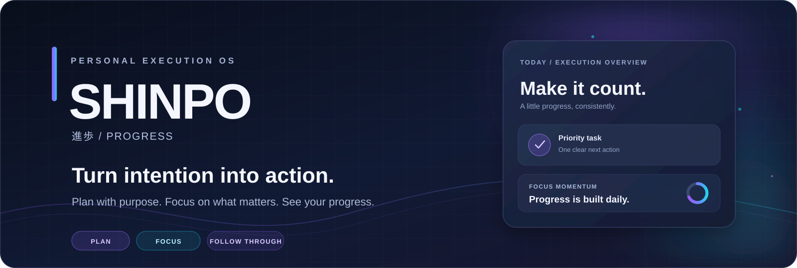
</p>

<p align="center">
  <sub>Plan deliberately. Protect your focus. Follow through.</sub>
</p>

---

## 💡 The Philosophy

**SHINPO (進歩)** is Japanese for *progress*. It is built around a continuous execution loop:

```text
🎯 Set Clear Direction  ➔  📋 Select Next Action  ➔  ⏱️ Deep Focus Session  ➔  📈 Review Momentum
```

Modern knowledge workers are inundated with scattered to-do apps, noisy calendars, and complex productivity trackers. SHINPO brings goals, task execution, pomodoro timing, schedule visibility, distraction protection, and progression analytics into a **single, unified, local-first cross-platform desktop workspace**.

> **No forced cloud sign-in. Zero telemetry. 100% locally encrypted on your disk.**

---

## 📥 Quick Download & Installation

SHINPO is packaged for **Linux x86_64** and **Windows 10/11 x64** with verified releases on the [GitHub Releases page](https://github.com/ronartz/SHINPO/releases):

| Platform | Package / Format | Target Environment | Download Link |
|---|---|---|---|
| **Windows** | **NSIS Installer (`.exe`)** | Windows 10 & 11 (64-bit) | [`SHINPO_windows_x64_setup.exe.zip`](https://github.com/ronartz/SHINPO/releases/latest) |
| **Linux** | **RPM Package (`.rpm`)** | Fedora 40/41, RHEL 9+, Rocky, AlmaLinux | [`SHINPO-latest-1.x86_64.rpm`](https://github.com/ronartz/SHINPO/releases/latest) |
| **Linux** | **Debian Package (`.deb`)** | Ubuntu, Debian, Linux Mint | [`SHINPO_latest_amd64.deb`](https://github.com/ronartz/SHINPO/releases/latest) |
| **Linux** | **AppImage (`.AppImage`)** | Universal single-file Linux executable | [`SHINPO_latest_amd64.AppImage`](https://github.com/ronartz/SHINPO/releases/latest) |
| **Linux** | **Portable Tarball (`.tar.gz`)** | Arch Linux, NixOS, or No-Root | [`SHINPO_latest_linux_x86_64.tar.gz`](https://github.com/ronartz/SHINPO/releases/latest) |
| **Browser** | **Chromium Companion** | Google Chrome, Brave, Microsoft Edge | [`shinpo-browser-companion-chromium.zip`](https://github.com/ronartz/SHINPO/releases/latest) |
| **Browser** | **Firefox Companion** | Mozilla Firefox | [`shinpo-browser-companion-firefox.zip`](https://github.com/ronartz/SHINPO/releases/latest) |

---

### 🪟 Windows 10 / 11 Installation Guide

1. Download [`SHINPO_windows_x64_setup.exe.zip`](https://github.com/ronartz/SHINPO/releases/latest) from Releases and extract it.
2. Run `SHINPO_0.1.0-beta.3_windows_x64_setup.exe`.
3. **Windows SmartScreen Note**: Because SHINPO is an independent private-beta release without an enterprise EV certificate:
   * When the blue *"Windows protected your PC"* banner appears, click **More info**.
   * Click **Run anyway**.
4. The installer completes in seconds and adds SHINPO to your Start Menu and Desktop.

---

### 🐧 Linux Installation Guide

#### Option 1: Fedora / RHEL (Recommended)
```bash
sudo dnf install ./SHINPO-*-1.x86_64.rpm
shinpo-desktop
```

#### Option 2: Ubuntu / Debian
```bash
sudo apt install ./SHINPO_*_amd64.deb
shinpo-desktop
```

#### Option 3: Universal AppImage
```bash
chmod +x SHINPO_*_amd64.AppImage
./SHINPO_*_amd64.AppImage
```

---

### 🌐 Browser Companion Setup (Windows & Linux)

The browser companion pairs securely with SHINPO to detect distracting browser tabs during active focus blocks with zero cloud reliance.

1. **Install Extension in Browser:**
   * **Chrome / Brave / Edge**: Go to `chrome://extensions` or `edge://extensions`, toggle **Developer Mode** on, click **Load unpacked**, and select the extracted `shinpo-browser-companion-chromium` directory.
   * **Firefox**: Go to `about:debugging#/runtime/this-firefox`, click **Load Temporary Add-on**, and choose `manifest.json` inside `shinpo-browser-companion-firefox`.
2. **Pair with SHINPO Desktop:**
   * Open SHINPO Desktop, go to **Settings → Browser Companion**.
   * Click **Generate Pairing Code** (SHINPO automatically registers the native messaging host in your OS registry / user config).
   * In the extension popup or options page, paste the code and click **Pair this browser**.
   * Status will turn green: **Connected & Protected**.

---

## ⚡ Inside SHINPO

<table>
  <tr>
    <td width="50%" valign="top">
      <h3>🎯 Goals &amp; Task Execution</h3>
      <p>Break high-level aspirations into manageable, actionable steps. Organize tasks with Kanban boards, list views, priority tags, and deadline scheduling.</p>
    </td>
    <td width="50%" valign="top">
      <h3>⏱️ Deep Focus Engine</h3>
      <p>Time-blocked focus sessions with customizable intervals (25m / 45m / 60m), fluid pause/resume controls, break timers, and post-session reflection notes.</p>
    </td>
  </tr>
  <tr>
    <td width="50%" valign="top">
      <h3>🗓️ Calendar &amp; Time Mapping</h3>
      <p>Schedule your week visually. Position focus blocks against deadlines, review execution history, and balance deep work across projects.</p>
    </td>
    <td width="50%" valign="top">
      <h3>🛡️ Focus Guardian</h3>
      <p>Gentle, non-destructive desktop observation. <strong>Warning-only:</strong> SHINPO alerts you with subtle overlays when distracting apps appear, but <em>never terminates your programs</em>.</p>
    </td>
  </tr>
  <tr>
    <td width="50%" valign="top">
      <h3>🌐 Browser Companion</h3>
      <p>Pairs with Chromium (Chrome, Brave, Edge) and Firefox via local native messaging to detect distracting tabs during focus blocks with zero cloud dependency.</p>
    </td>
    <td width="50%" valign="top">
      <h3>✦ EONPAI AI Assistant</h3>
      <p>Autonomous task decomposition and intention planning. Runs 100% offline via deterministic rule sets, with optional local Ollama or OpenAI-compatible endpoint support.</p>
    </td>
  </tr>
  <tr>
    <td width="50%" valign="top">
      <h3>📈 Velocity &amp; Analytics</h3>
      <p>Visualize completion rates, focus streaks, XP gain, milestone achievements, and velocity trends to stay motivated over months of deliberate work.</p>
    </td>
    <td width="50%" valign="top">
      <h3>🎨 Aurora &amp; Classic Themes</h3>
      <p>Meticulously styled with four color schemes: <strong>Aurora Dark</strong>, <strong>Classic Dark</strong>, <strong>Aurora Light</strong>, and <strong>Classic Light</strong> with GPU-accelerated glassmorphism.</p>
    </td>
  </tr>
</table>

---

## 🖼️ Screenshots Gallery

A visual tour through the SHINPO desktop workspace (captured in **Aurora Dark** theme):

<table>
  <tr>
    <td width="50%" valign="top">
      <h4 align="center">📊 Dashboard Overview</h4>
      <p align="center"><sub>Daily priorities, focus streaks, upcoming milestones, and quick-actions.</sub></p>
      <a href="docs/qa/screenshots/final/01_dashboard_aurora-dark.png">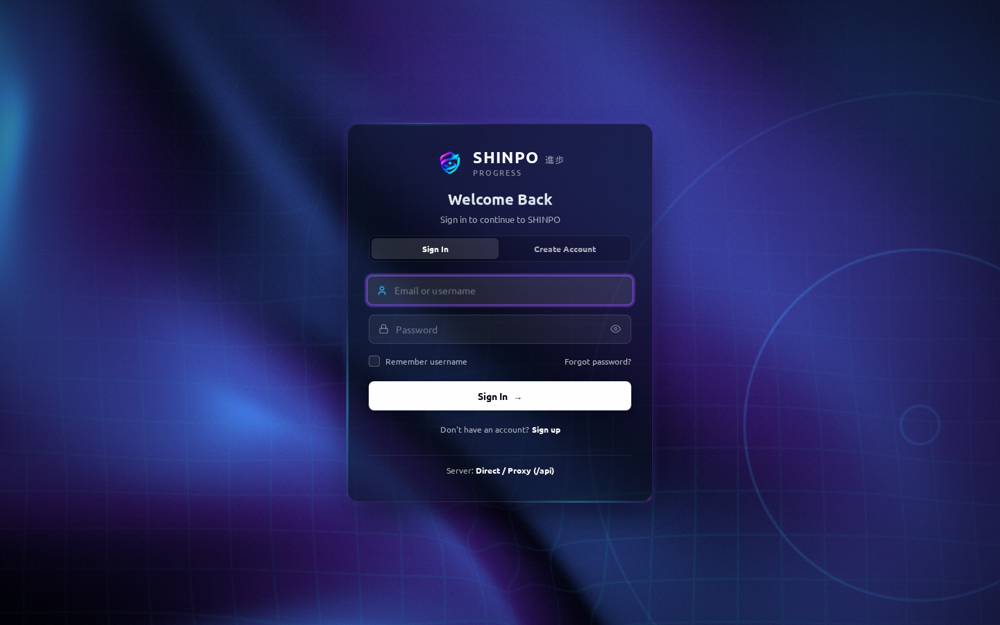</a>
    </td>
    <td width="50%" valign="top">
      <h4 align="center">🎯 Goals &amp; Tasks Kanban</h4>
      <p align="center"><sub>Organize projects by execution state: Backlog, Next, In Progress, and Completed.</sub></p>
      <a href="docs/qa/screenshots/final/02_goals_tasks_aurora-dark.png">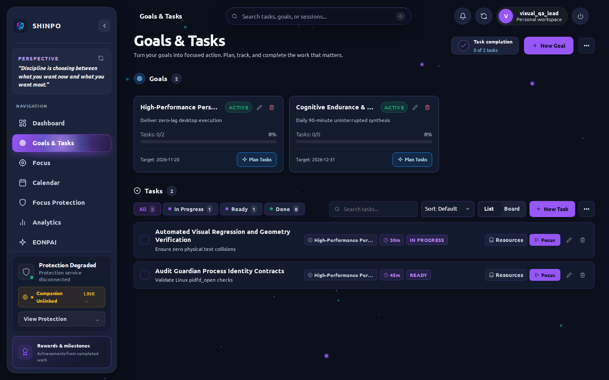</a>
    </td>
  </tr>
  <tr>
    <td width="50%" valign="top">
      <h4 align="center">⏱️ Deep Focus Engine</h4>
      <p align="center"><sub>Immersive session timer with pause resilience and post-session reflection.</sub></p>
      <a href="docs/qa/screenshots/final/03_focus_engine_aurora-dark.png">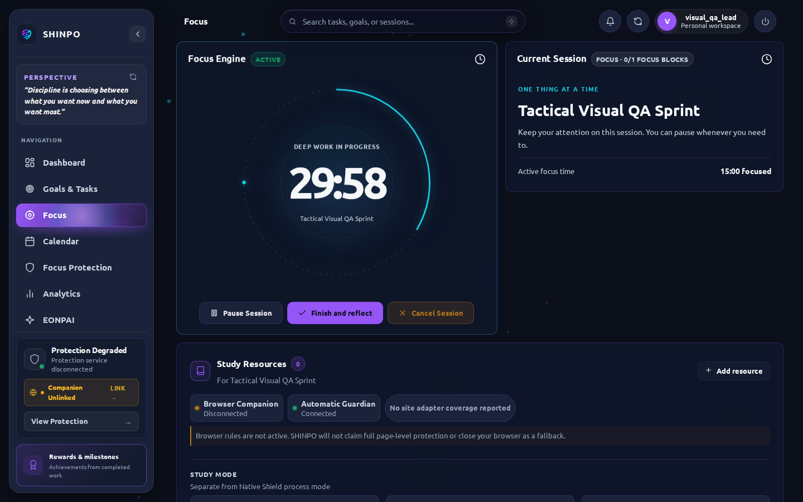</a>
    </td>
    <td width="50%" valign="top">
      <h4 align="center">🗓️ Calendar &amp; Scheduler</h4>
      <p align="center"><sub>Time-block deep work sessions across days and visualize weekly load.</sub></p>
      <a href="docs/qa/screenshots/final/06_schedule_calendar_aurora-dark.png">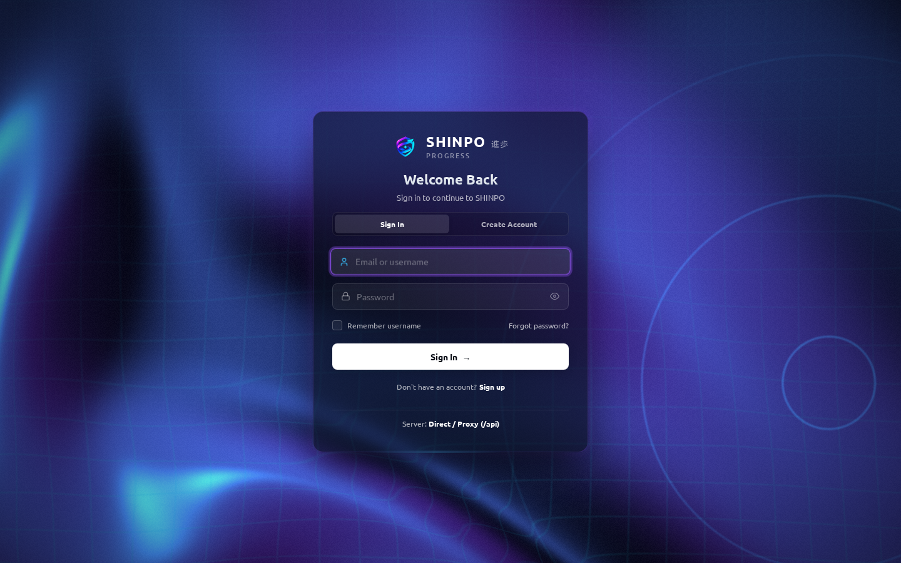</a>
    </td>
  </tr>
  <tr>
    <td width="50%" valign="top">
      <h4 align="center">📈 Analytics &amp; Streaks</h4>
      <p align="center"><sub>Review long-term productivity patterns, completion velocity, and XP milestones.</sub></p>
      <a href="docs/qa/screenshots/final/04_analytics_aurora-dark.png">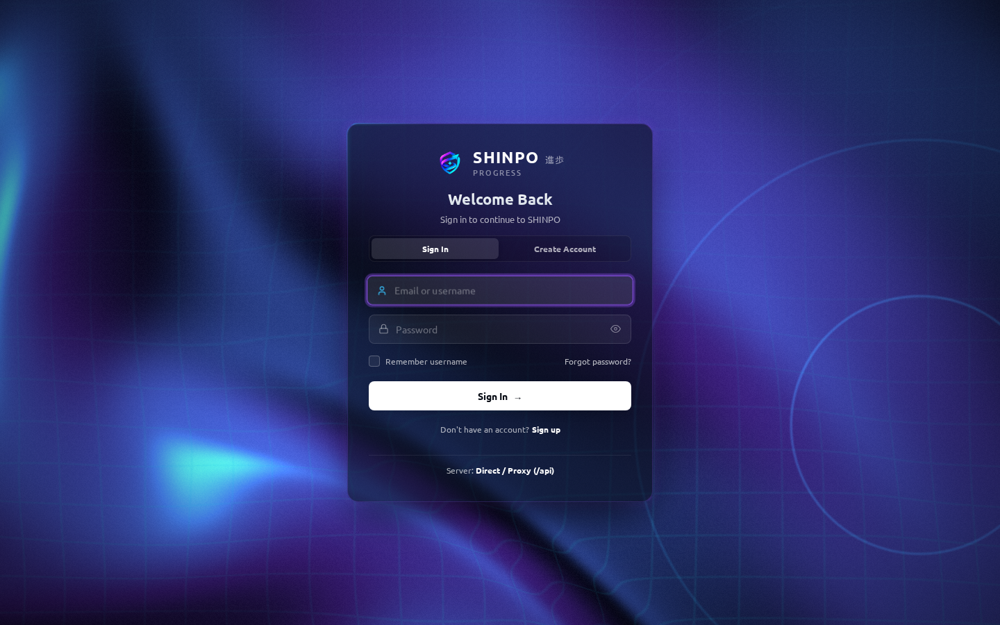</a>
    </td>
    <td width="50%" valign="top">
      <h4 align="center">✦ EONPAI AI Planning Assistant</h4>
      <p align="center"><sub>Decompose fuzzy ideas into structured, manageable, and actionable subtasks.</sub></p>
      <a href="docs/qa/screenshots/final/08_eonpai_assistant_aurora-dark.png">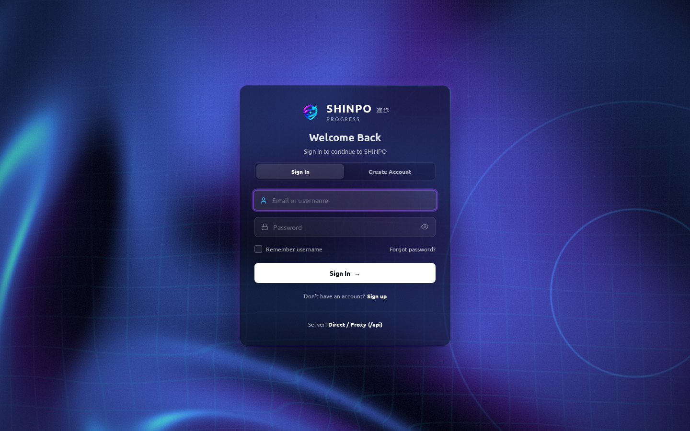</a>
    </td>
  </tr>
</table>

<details>
<summary><strong>🔍 Click to view Classic Dark Theme previews</strong></summary>
<br />

<table>
  <tr>
    <td width="50%" valign="top">
      <h4 align="center">Classic Dark — Dashboard</h4>
      <a href="docs/qa/screenshots/final/01_dashboard_classic-dark.png">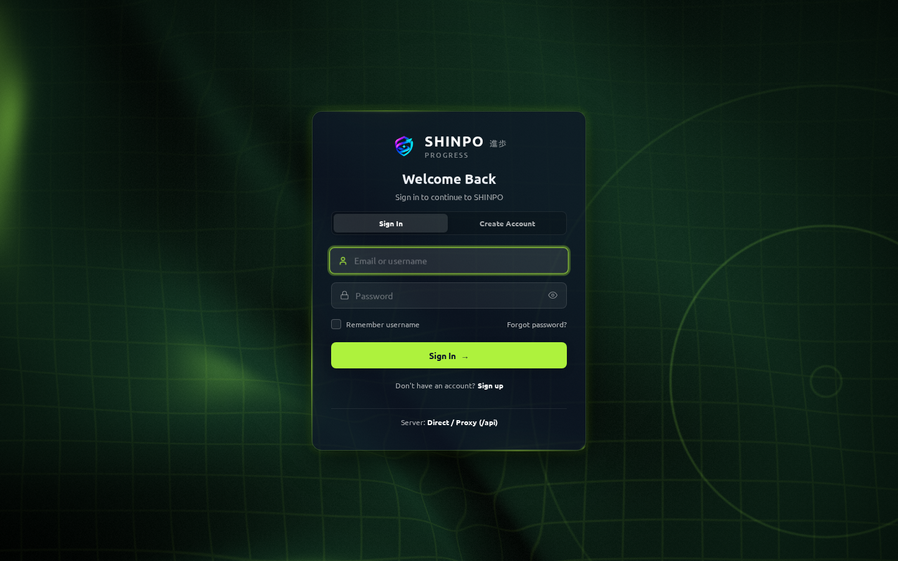</a>
    </td>
    <td width="50%" valign="top">
      <h4 align="center">Classic Dark — Goals &amp; Tasks</h4>
      <a href="docs/qa/screenshots/final/02_goals_tasks_classic-dark.png">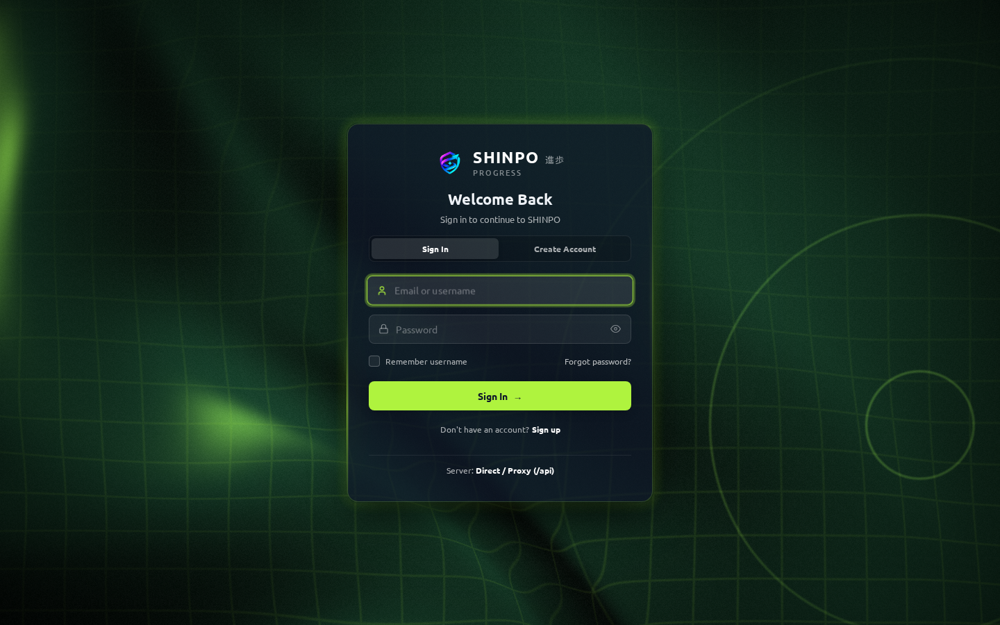</a>
    </td>
  </tr>
  <tr>
    <td width="50%" valign="top">
      <h4 align="center">Classic Dark — Focus Engine</h4>
      <a href="docs/qa/screenshots/final/03_focus_engine_classic-dark.png">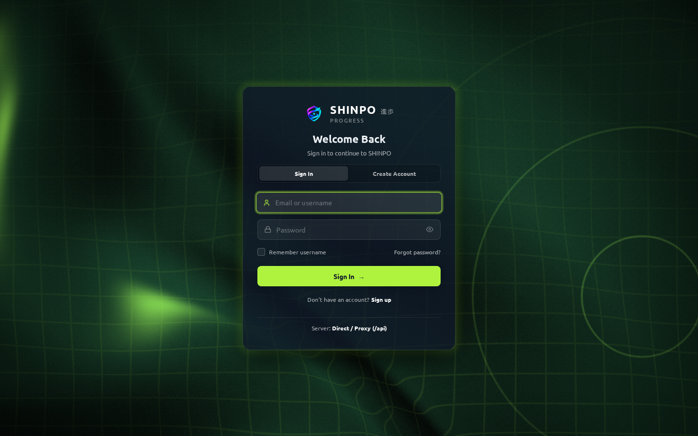</a>
    </td>
    <td width="50%" valign="top">
      <h4 align="center">Classic Dark — Analytics</h4>
      <a href="docs/qa/screenshots/final/04_analytics_classic-dark.png">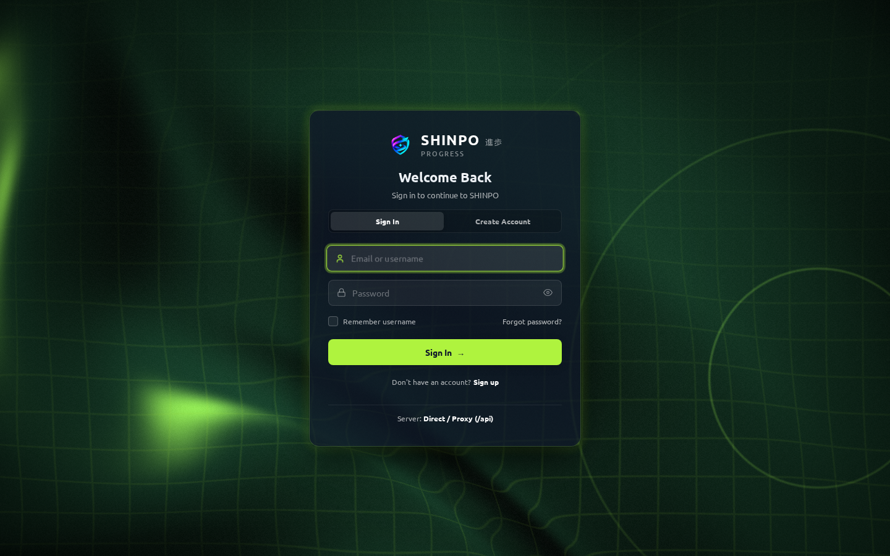</a>
    </td>
  </tr>
</table>
</details>

---

## 🏗️ How the Pieces Fit Together

SHINPO is built on a high-efficiency architecture separating native OS capabilities from the fluid user interface:

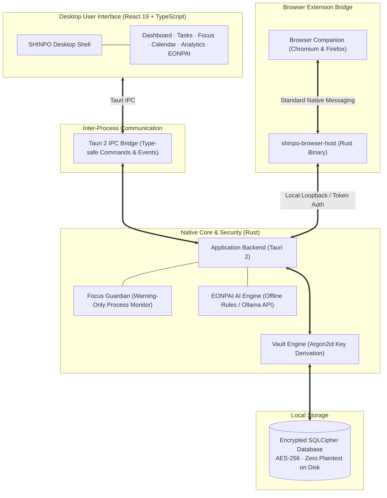

### Technology Matrix

| Layer | Technology | Key Responsibility |
|---|---|---|
| **Desktop Shell** | [Tauri 2](https://v2.tauri.app/) · Rust | Native window management, low-memory footprint, secure IPC |
| **User Interface** | [React 19](https://react.dev/) · TypeScript · Vite | Reactive state management, glassmorphism UI, accessible navigation |
| **Local Vault** | [SQLCipher](https://www.zetetic.net/sqlcipher/) · [Argon2id](https://en.wikipedia.org/wiki/Argon2) | 256-bit AES database encryption, zero plaintext on disk |
| **Focus Guardian** | Rust `sysinfo` · OS Process Watcher | Non-destructive, warning-only distraction detection |
| **Browser Companion** | WebExtensions Manifest v3 | Chromium & Firefox distraction detection via native messaging |
| **AI Intelligence** | Local Deterministic Rules / Ollama | Local task decomposition; zero external network required |

---

## 🔒 Privacy & Security Guarantees

SHINPO is architected around the core principle that **your intentions, goals, and notes belong to you alone**:

1. **Local-Only Encrypted Vault:** All personal application data is stored in a local SQLCipher-backed database encrypted with **256-bit AES**. Encryption keys are derived via **Argon2id** from your Master Passphrase.
2. **Zero Plaintext on Disk:** Byte-level disk forensics verify that zero unencrypted task titles, goal descriptions, or reflection notes are ever written to disk.
3. **Focus Guardian is Non-Destructive:** Focus Guardian is strictly **warning-only**. It never closes, terminates, or interferes with your running desktop software.
4. **Explicit Browser Pairing:** The browser companion communicates only through local stdin/stdout native messaging with a short-lived, single-use pairing token.
5. **AI Privacy:** EONPAI functions 100% offline using deterministic local heuristics. Connecting external LLM endpoints (such as Ollama or OpenAI-compatible APIs) is strictly opt-in.

---

## 🛠️ Run from Source

### Prerequisites
- Node.js 22+ and npm
- Rust toolchain (1.80+) and Cargo
- Linux development headers: `libwebkit2gtk-4.1-dev`, `libssl-dev`, `libayatana-appindicator3-dev`

### Development Setup
```bash
# 1. Clone repository
git clone git@github.com:ronartz/SHINPO.git
cd SHINPO

# 2. Install frontend dependencies
npm --prefix frontend ci

# 3. Launch Tauri desktop development app with hot-reload
npm --prefix frontend run tauri:dev
```

### Production Build
```bash
# Compile desktop binaries and installers
npm --prefix frontend run tauri:build
```

---

## 📚 Documentation & Architecture

- 🐧 [Linux Installation Guide](docs/INSTALL_LINUX.md)
- 🌐 [Browser Companion Setup](docs/Browser-Companion-Install.md)
- ⚠️ [Known Limits & Beta Characteristics](docs/KNOWN_LIMITS.md)
- 🏗️ [Standalone Runtime Architecture](docs/architecture/STANDALONE_RUNTIME.md)
- 💻 [Frontend Architecture](docs/architecture/FRONTEND_ARCHITECTURE.md)
- 📖 [API Reference](docs/architecture/API_REFERENCE.md)
- 📐 [Engineering Standards](docs/architecture/CODE_STANDARDS.md)

---

## 📜 License

**Proprietary · All rights reserved.**  
Unauthorized copying, reverse engineering, redistribution, or commercial use is strictly prohibited. Access to this source repository is granted solely for authorized private beta evaluation.

<br />

<div align="center">
  <strong>進歩 — Small steps. Meaningful progress.</strong><br />
  <sub>SHINPO is engineered for builders who want to spend less time managing productivity apps and more time doing meaningful work.</sub>
</div>
