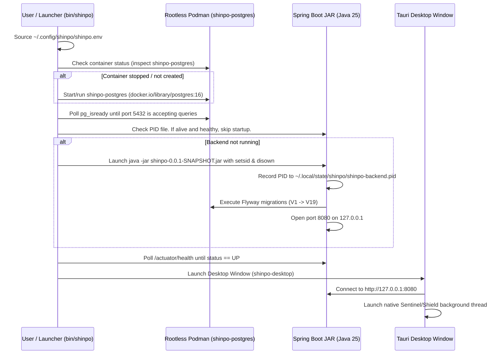

# SHINPO — Standalone Runtime Architecture & Operations Manual

This document defines the production architecture, runtime lifecycle, and operational procedures for running SHINPO as a self-contained, offline-capable desktop application on Fedora Linux (and other desktop environments).

---

## 1. Runtime Topology & Component Map

SHINPO runs entirely on the user's local machine without external cloud dependencies, paid infrastructure, or remote databases.

```text
┌─────────────────────────────────────────────────────────────────────────────┐
│                             DESKTOP ENVIRONMENT                             │
│                                                                             │
│   ┌─────────────────────────────────────────────────────────────────────┐   │
│   │                        SHINPO Desktop Shell                         │   │
│   │   - Tauri 2.12.1 Native Window (GTK / WebKitGTK on Linux)           │   │
│   │   - Embedded Rust Native Shield Thread (cgroup/process interceptor) │   │
│   │   - Packaged Static Frontend (Vite + React SPA from ../dist)        │   │
│   └──────────────────────────────────┬──────────────────────────────────┘   │
│                                      │ HTTP / WebSocket                     │
│                                      │ (http://127.0.0.1:8080)              │
│                                      ▼                                      │
│   ┌─────────────────────────────────────────────────────────────────────┐   │
│   │                     Spring Boot 4 Backend Service                   │   │
│   │   - Standalone Fat JAR (OpenJDK 25.0.4.1)                           │   │
│   │   - Process PID: ~/.local/state/shinpo/shinpo-backend.pid           │   │
│   │   - Logs: ~/.local/share/shinpo/shinpo-backend.log                  │   │
│   │   - Bound strictly to 127.0.0.1:8080 (Loopback Only)                │   │
│   │   - Flyway Schema Migrations (V1 through V19)                       │   │
│   └──────────────────┬───────────────────────────────┬──────────────────┘   │
│                      │ JDBC (localhost:5432)         │ HTTP (localhost:11434)│
│                      ▼                               ▼                      │
│   ┌───────────────────────────────────┐    ┌────────────────────────────┐   │
│   │   Rootless PostgreSQL 16 (Podman) │    │  Ollama Local LLM (Opt.)   │   │
│   │   - Container: shinpo-postgres    │    │  - Model: qwen3:4b         │   │
│   │   - Volume: shinpo-pgdata         │    │  - Fallback: Mock provider │   │
│   │   - Port: 127.0.0.1:5432          │    └────────────────────────────┘   │
│   └───────────────────────────────────┘                                     │
└─────────────────────────────────────────────────────────────────────────────┘
```

---

## 2. Directory Structure & Standard Paths (XDG Compliant)

All per-user configuration and application states strictly adhere to XDG Base Directory standards:

| Path | Purpose | Permissions |
| :--- | :--- | :--- |
| `~/.config/shinpo/shinpo.env` | Standalone environment file containing cryptographically generated JWT keys and DB credentials | `0600` (`-rw-------`) |
| `~/.local/state/shinpo/shinpo-backend.pid` | PID tracking file for the standalone Spring Boot JAR process | `0644` |
| `~/.local/share/shinpo/shinpo-backend.log` | Rolling application runtime log for backend inspection | `0644` |
| `~/.local/share/containers/storage/` | Rootless Podman volume storage for `shinpo-postgres` database files | Managed by Podman |
| `~/.local/share/shinpo/shield_spool.json` | Offline spooling storage for Shield enforcement quarantine events | `0600` |

---

## 3. Configuration & Secret Management

Secrets are never hardcoded in source files or configuration scripts.

Upon first launch, `scripts/shinpo-runtime.sh` (or `bin/shinpo`) inspects `~/.config/shinpo/shinpo.env`. If absent, it automatically generates a 256-bit cryptographic JWT secret using `openssl rand -hex 32` and writes the configuration with restricted file permissions (`chmod 600`):

```bash
# SHINPO Local Standalone Environment Configuration
SERVER_ADDRESS=127.0.0.1
SERVER_PORT=8080

POSTGRES_HOST=127.0.0.1
POSTGRES_PORT=5432
POSTGRES_DB=shinpo
POSTGRES_USER=shinpo
POSTGRES_PASSWORD=shinpo_dev

# Cryptographically generated 256-bit JWT signing secret
SHINPO_JWT_SECRET=<64-character hex string>

# EONPAI AI Provider Settings (Local Ollama)
SHINPO_AI_ENABLED=true
SHINPO_AI_PROVIDER=ollama
SHINPO_AI_OLLAMA_BASE_URL=http://localhost:11434
SHINPO_AI_OLLAMA_MODEL=qwen3:4b
```

---

## 4. Lifecycle & Process Management

### Startup Sequence



### Shutdown Sequence

1. **Desktop Window Close**: The user closes the Tauri desktop window. The embedded Shield enforcement thread terminates gracefully.
2. **Backend Shutdown (`bin/shinpo stop`)**:
   - Sends `SIGTERM` to the PID recorded in `~/.local/state/shinpo/shinpo-backend.pid`.
   - Waits up to 10 seconds for graceful connection draining and Hikari connection pool release.
   - Cleans up PID file upon exit.
3. **Database Container**: Remains persisted in background or stops via container command without data loss.

---

## 5. Fedora Packaging & Distribution Direction

For Fedora Linux workstations (x86_64), SHINPO leverages native Linux bundling capabilities built into Tauri:

1. **RPM Package (`.rpm`)**:
   - Generated using Tauri's native `rpmbuild` integration.
   - Configuration in `frontend/src-tauri/tauri.conf.json`:
     ```json
     "bundle": {
       "active": true,
       "targets": ["rpm", "appimage", "nsis"],
       "linux": {
         "rpm": {
           "release": "1"
         }
       }
     }
     ```
   - Installs desktop launcher `.desktop` file to `/usr/share/applications/` and icon assets to `/usr/share/icons/hicolor/`.
2. **AppImage (`.AppImage`)**:
   - Standalone portable single-file binary containing bundled WebKitGTK libraries and runtime dependencies.

---

## 6. CLI Reference: `bin/shinpo`

The repository provides a single unified entry point `bin/shinpo` (symlinked to `scripts/shinpo-runtime.sh`):

```bash
# Check status of PostgreSQL, Backend process, and Health endpoint
./bin/shinpo status

# Start PostgreSQL and Backend in the background
./bin/shinpo start

# Stop the Backend process cleanly
./bin/shinpo stop

# Restart Backend cleanly without port conflicts
./bin/shinpo restart

# Tail backend runtime logs
./bin/shinpo logs

# Start backend (if not running) and open desktop application
./bin/shinpo desktop
```

