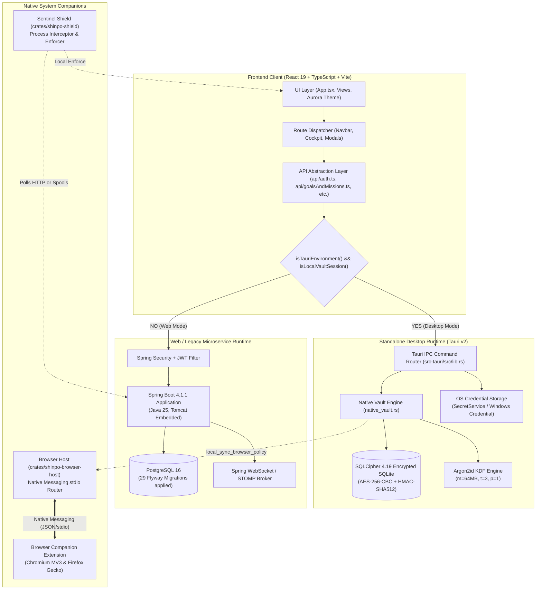

# SHINPO — ARCHITECTURE AND DATA INTEGRITY AUDIT
**Audit Date:** October 26–27, 2026  
**Auditor:** Principal Software Architect

---

## 1. Architectural System Overview

SHINPO is structured in a hybrid dual-stack topology:



---

## 2. Runtime Service Dependency Matrix

| Module / Feature | Required in Desktop Mode | Required in Web Mode | Standalone Desktop Capability |
|---|---|---|---|
| **User Authentication** | OS Keyring + SQLCipher | Spring Security + PostgreSQL | **YES** (100% Offline) |
| **Goals & Projects** | SQLCipher (`goals` table) | PostgreSQL (`goals` table) | **YES** (100% Offline) |
| **Task Management** | SQLCipher (`tasks` table) | PostgreSQL (`missions` table) | **YES** (100% Offline) |
| **Calendar & Scheduling**| SQLCipher (`calendar_sessions`) | PostgreSQL (`focus_sessions`) | **YES** (100% Offline) |
| **Focus Timer & Breaks** | SQLCipher (`calendar_sessions`) | PostgreSQL (`focus_sessions`) | **YES** (100% Offline) |
| **XP & Rewards Ledger** | SQLCipher (`progress_events`) | PostgreSQL (`rewards` / progress) | **YES** (100% Offline) |
| **Analytics Dashboard** | In-memory JS Aggregation | Spring Boot SQL Queries | **PARTIAL** (Simplified in desktop) |
| **Browser Companion** | `shinpo-browser-host` | Spring Boot + Browser Host | **YES** (Local file sync) |
| **Sentinel Shield** | Local Process Interceptor | Spring Boot Polling (`/api/sentinel`) | **PARTIAL** (Defaults to port 8080) |
| **EONPAI AI Assistant** | **None (BROKEN)** | Spring Boot (`/api/ai/*`) + Ollama/Gemini | **NO (Hard Blocker)** |

---

## 3. Remote Service Residue & Hardcoded Endpoints

The audit detected multiple hardcoded references to `localhost:8080` in the desktop codebase:

1. **`frontend/src-tauri/tauri.conf.json` (Line 34):**
   ```json
   "connect-src": "ipc: http://ipc.localhost http://localhost:8080 http://127.0.0.1:8080 https: wss: ws://localhost:5173"
   ```
   *Analysis:* The desktop CSP explicitly permits unencrypted HTTP calls to loopback port 8080.
2. **`frontend/src-tauri/src/lib.rs` (Line 147):**
   ```rust
   let url = shinpo_shield::config::validate_backend_url(
       &api_url.unwrap_or_else(|| "http://localhost:8080".to_string()),
   )?;
   ```
   *Analysis:* Starting Sentinel Shield from Tauri falls back to polling `http://localhost:8080` if an explicit URL is not supplied.
3. **`frontend/src/api/config.ts` (Line 1):**
   ```typescript
   export function getBackendBaseUrl(): string {
     return import.meta.env.VITE_API_URL || 'http://localhost:8080'
   }
   ```
   *Analysis:* When running in web mode or when a non-local API call is made, the frontend defaults to port 8080.

---

## 4. Database Schema Parity Gap

### PostgreSQL Schema (29 Migrations)
1. `V1__create_core_tables.sql`: `goals`, `missions`
2. `V2__create_focus_sessions.sql`: `focus_sessions`
3. `V3__add_pause_tracking_to_focus_sessions.sql`
4. `V4__create_session_plans.sql`: `session_plans`
5. `V5__add_plan_to_focus_sessions.sql`
6. `V6__add_session_result_to_focus_sessions.sql`
7. `V7__create_ai_suggestions.sql`: `ai_suggestions`
8. `V8__create_auth_tables.sql`: `users`, `refresh_tokens`
9. `V9__create_bug_reports.sql`: `bug_reports`
10. `V10__create_conversations.sql`: `conversations`
11. `V11__add_user_roles.sql`: `user_roles`
12. `V12__one_active_conversation_per_user.sql`
13. `V13__create_sentinel_quarantine_and_policy_tables.sql`: `sentinel_quarantine_events`, `sentinel_policy`
14. `V14__create_sentinel_tamper_events.sql`: `sentinel_tamper_events`
15. `V15__create_focus_session_enforcement_exceptions.sql`: `focus_session_enforcement_exceptions`
16. `V16__create_sentinel_warnings_and_grace_windows.sql`: `sentinel_warnings`, `sentinel_grace_windows`
17. `V17__add_enforcement_mode_to_users.sql`
18. `V18__add_user_status_index_to_focus_sessions.sql`
19. `V19__create_ai_actions.sql`: `ai_actions`
20. `V20__create_contextual_focus_policy.sql`: `contextual_focus_policy`, `study_resources`
21. `V21__add_token_version_to_users.sql`
22. `V22__create_user_onboarding.sql`: `user_onboarding`
23. `V23__unique_onboarding_reward.sql`
24. `V24__onboarding_started_at.sql`
25. `V25__idempotent_goal_completion_rewards.sql`
26. `V26__persist_pomodoro_phases_and_focus_rewards.sql`
27. `V27__focus_break_grace_lifecycle.sql`
28. `V28__scope_contextual_resources_to_breaks.sql`
29. `V29__index_completed_focus_analytics.sql`

### SQLCipher Native Vault Schema (`native_vault.rs`)
1. `local_profile`: `(id INTEGER PRIMARY KEY, username TEXT, recovery_hash TEXT, created_at TEXT)`
2. `goals`: `(id INTEGER PRIMARY KEY, title TEXT, description TEXT, status TEXT, start_date TEXT, target_date TEXT, created_at TEXT, updated_at TEXT)`
3. `tasks`: `(id INTEGER PRIMARY KEY, goal_id INTEGER, title TEXT, description TEXT, status TEXT, scheduled_date TEXT, estimated_minutes INTEGER, actual_minutes INTEGER, created_at TEXT, updated_at TEXT)`
4. `calendar_sessions`: `(id INTEGER PRIMARY KEY, name TEXT, intention TEXT, task_id INTEGER, scheduled_date TEXT, start_time TEXT, duration_minutes INTEGER, active_seconds INTEGER, status TEXT, started_at TEXT, ended_at TEXT, completion_quality INTEGER, accomplishment TEXT, reflection_note TEXT, current_phase TEXT, pomodoro_phase TEXT, break_duration_seconds INTEGER, active_seconds_at_pause INTEGER, paused_at TEXT, break_grace_seconds INTEGER, created_at TEXT, updated_at TEXT)`
5. `progress_events`: `(id INTEGER PRIMARY KEY, event_type TEXT, xp_amount INTEGER, source_entity_id INTEGER, entity_type TEXT, created_at TEXT)`
6. `browser_resources`: `(id INTEGER PRIMARY KEY, destination TEXT, display_name TEXT, disposition TEXT, match_type TEXT, resource_type TEXT, break_only INTEGER, expires_at TEXT, mission_id INTEGER, focus_session_id INTEGER, created_at TEXT)`
7. `browser_companion_meta`: `(key TEXT PRIMARY KEY, value TEXT)`

### Architectural Gaps Between Engines
| Feature | In PostgreSQL | In SQLCipher | Architectural Impact |
|---|---|---|---|
| AI Conversations & Chat History | `conversations`, `ai_suggestions` | **MISSING** | Chat cannot persist in local desktop mode. |
| AI Tool Actions & Audits | `ai_actions` | **MISSING** | Automated planning actions cannot be audited locally. |
| Sentinel Warnings & Grace Windows | `sentinel_warnings`, `sentinel_grace_windows` | **MISSING** | Process grace states are kept in memory only; lost on crash. |
| Sentinel Quarantine Log | `sentinel_quarantine_events` | Spooled to disk (`.shinpo_quarantine.spool`) | Stored in unencrypted text file rather than SQLCipher. |
| Task Table Naming | `missions` | `tasks` | Requires field name mapping layer between API DTOs. |

---

## 5. Complete Frontend Routes & Views

The frontend defines 8 primary views in `frontend/src/App.tsx`:
1. `Dashboard` (`ThemedAuroraDashboardView` or `OverviewView`)
2. `Goals & Missions` (`GoalsView` with List & Kanban switcher)
3. `Focus Engine` (`FocusView` with Pomodoro timer & break engine)
4. `Schedule` (`ScheduleView` with Day/Week timeline)
5. `Task Manager` (`TaskManagerView` with filter/search)
6. `Analytics` (`AnalyticsView` with velocity charts & debriefs)
7. `Rewards` (`RewardsView` with Duolingo-style milestones)
8. `AI Assistant` (`EonpaiView` with multi-turn chat & intent cards)
9. Modals: `SettingsModal`, `AchievementsModal`, `SessionSummaryModal`, `CreateTaskModal`, `TutorialOverlay`

